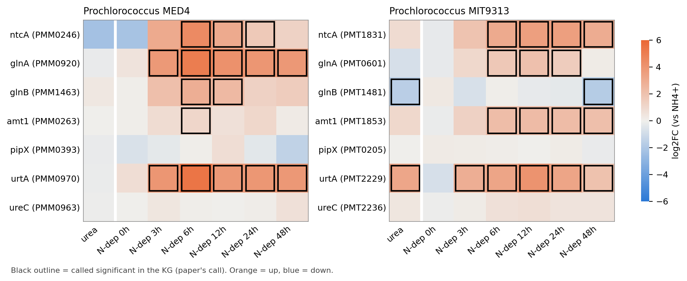

# NtcA expression in *Prochlorococcus* grown on urea versus ammonium

## Question
Does the global nitrogen regulator NtcA respond when *Prochlorococcus* grows on urea instead of ammonium, as it does under nitrogen deprivation?

## Methods
We reanalysed transcriptome microarray data from Tolonen et al. (2006) for two strains, MED4 and MIT9313. Each strain had steady-state, exponentially growing cultures acclimated to urea as the sole nitrogen source, and matched cultures on ammonium. We read out *ntcA* (PMM0246, PMT1831) and six NtcA-associated genes: *glnA*, *glnB*, *amt1*, *urtA*, *ureC* and *pipX*. Significance follows the original study's calls. Each gene's |log2 fold change| was ranked as a percentile among all genes in the experiment. As a method check we used the same study's nitrogen-deprivation time course (0–48 h, same platform). We pre-registered two things before the analysis: a falsification rule (urea induces *ntcA* together with at least two of *glnA*, *amt1* and *glnB*), and an expected-negative (the 53 ribosomal-protein genes per strain should not shift together).

## Results
Under nitrogen deprivation, *ntcA* was significantly induced in both strains, up to 22-fold in MED4 (6 h) and 12-fold in MIT9313 (12 h). So were *glnA* and *amt1*. *glnB* was induced in MED4 but not in MIT9313.

On urea, *ntcA* was not significantly changed in either strain. In MED4 the estimated change was large (log2FC −2.27, 99.7th percentile) but not called significant. In MIT9313 it was +0.86 (92nd percentile), also not called. In MED4, none of the six associated genes changed appreciably (all below the 70th percentile). In MIT9313, the urea transporter gene *urtA* was strongly induced (log2FC +3.20) and *glnB* was repressed (−1.62). *glnA* (−0.76) and *amt1* (+1.02) fell around the 90th percentile and were not called significant. *glnB* was also repressed at 48 h of nitrogen deprivation (−1.75). Ribosomal-protein genes did not shift together in either strain: median percentile 27 and 62, with 62–64% negative.

## Conclusion
| Finding | MED4 | MIT9313 |
|---|---|---|
| *ntcA* significantly changed on urea | No (large estimate, not significant) | No |
| NtcA-dependent N-stress genes induced on urea | No | No (*urtA* up, *glnB* down) |
| Positive control: *ntcA* induced by N deprivation | Yes | Yes |
| Ribosomal-protein genes (expected not to shift) | Did not shift | Did not shift |

1. In neither strain does growth on urea produce the *ntcA*-plus-targets signature of nitrogen stress that the same arrays detect under nitrogen deprivation. Urea-acclimated cells do not appear nitrogen-stressed at the transcript level.
2. MIT9313 shows a substrate-specific response to urea: its urea transporter gene is induced without broad induction of the N-stress genes.
3. The large estimated change in MED4 *ntcA* was not called significant. These data can neither confirm nor dismiss it.

## Caveats
- Single steady-state samples cannot reveal a transient NtcA response during the switch to urea.
- The analysis uses the original study's binary significance calls. Replicate-level variance was not available, so the MED4 *ntcA* estimate can be neither confirmed nor dismissed. A similar non-significant decrease appears at the 0 h point of the deprivation series.
- *glnB* was not induced by nitrogen deprivation in MIT9313. This departs from the pre-registered method check. It was repressed in both experiments, so it is uninformative as an NtcA-induction readout in that strain. A probe or mapping artefact cannot be excluded.
- Ribosomal-protein genes in MIT9313 showed a moderately elevated spread on urea (median percentile 62 vs 27 in MED4), below the pre-registered failure threshold.
- The ammonium reference cultures were matched by growth state; same-day harvest is not documented. Whether they share arrays with the deprivation series is unknown.
- Transcript abundance of *ntcA* is an indirect measure of NtcA activity, which is also regulated post-translationally.
